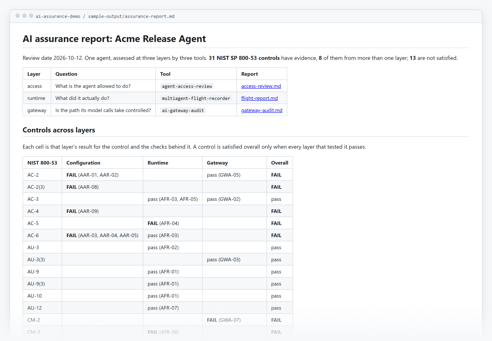

# ai-assurance-demo

**One AI agent, assessed end to end: what it's allowed to do, what it actually did, and whether the path its model calls take is controlled. Three open-source tools, one OSCAL bundle.**

[](sample-output/assurance-report.md)

**→ [Read the combined report](sample-output/assurance-report.md)** (no install needed).

## Why

An auditor reviewing an AI agent asks three different questions, and each has its own evidence:

| Layer | Question | Evidence | Tool |
|---|---|---|---|
| Configuration | What is the agent allowed to do? | Its manifest and MCP client config | [agent-access-review](https://github.com/Mihirajmera/agent-access-review) |
| Runtime | What did it actually do? | A signed, hash-chained log of every tool call | [multiagent-flight-recorder](https://github.com/Mihirajmera/agent-flight-recorder) |
| Gateway | Is the path its model calls take controlled? | The LiteLLM gateway's config and deployment | [ai-gateway-audit](https://github.com/Mihirajmera/ai-gateway-audit) |

Each tool answers one question and exports OSCAL. `assure.py` runs all three on the same agent and merges the results, so a control is judged on every layer that has evidence for it.

## The scenario

Acme's **Release Agent** (`release-bot`) works in GitHub on behalf of its owner, dana. Everything is fictional and in [`scenario/`](scenario):

- [`agents.yaml`](scenario/agents.yaml): the governed manifest. Merges and deletions need a human; the last approval was 104 days ago.
- [`.mcp.json`](scenario/.mcp.json): the config actually deployed. It runs the archived `@modelcontextprotocol/server-github` from npm, unpinned.
- [`runtime/flight.jsonl`](scenario/runtime/flight.jsonl): a signed log of one session. The agent reads a pull request, is blocked from pushing to `main`, waits for approval to merge, and dana approves her own agent's branch deletion. Mid-session, the server changes a tool's description.
- [`gateway/`](scenario/gateway): the LiteLLM gateway its model calls go through. Mostly hardened, with no spend cap and an image pinned by tag rather than digest.

## What the combined view shows

Read one layer at a time and you get three partial answers. Together:

- **AC-6, least privilege:** the config grants merge and delete without approval (AAR-03, fail), while the runtime log shows every merge waited for a human (AFR-03, pass). Both are true. The approval only exists because the recorder sits in the path, so the control stays **failed** until the config itself requires it.
- **SI-7, integrity:** fails at two layers for different reasons. The MCP server changed a tool description mid-session (AFR-06), and the gateway image can be swapped under its tag (GWA-07).
- **AC-5, separation of duties:** only runtime evidence can catch it. The manifest names dana as owner, and the log shows dana approving her own agent's action (AFR-04).
- **31 NIST SP 800-53 controls** have evidence, 8 of them from more than one layer, and 13 are not satisfied.

## Run it

```bash
pip install -r requirements.txt
python assure.py --out assurance
```

Output:

```
assurance/
  assurance-report.md          controls rolled up across the three layers
  oscal/assessment-results.json  one OSCAL assessment-results, one result per layer
  manifest.sha256              SHA-256 of every file in the bundle
  access/  runtime/  gateway/  each tool's own report, CSV, hashed evidence and OSCAL
```

Every evidence link in the merged OSCAL is rewritten to point at the file it came from, and the tests check that each one resolves. With `SOURCE_DATE_EPOCH` set, the bundle is byte-identical on every run. CI rebuilds it on each push, compares it with the committed [`sample-output/`](sample-output), and posts the report to the job summary.

To assess your own agent, replace the files in `scenario/` with your manifest, MCP config, flight log and gateway config.

## Limits

- The scenario is synthetic. The flight log is the recorder's scripted session, not a production trace.
- The merged OSCAL follows the same structure as the three tools' output. It isn't validated against NIST's JSON schema yet.
- The roll-up is mechanical: a control fails if any layer fails it. Deciding whether one layer's evidence compensates for another (as in AC-6 above) is still the reviewer's call, which is why the report shows each layer separately.

## License

MIT
